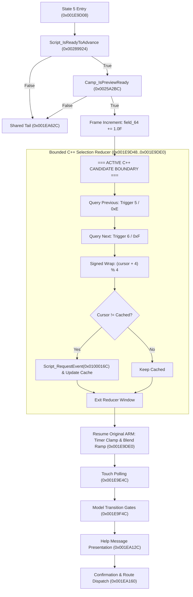

# H1 main callback editable readiness assessment — `0x001E989C`

**Task ID:** `h1-main-callback-editable-readiness`  
**Milestone:** H1 (Main menu integration)  
**Role:** Recon / Readiness Audit  
**Owner:** `recon-worker-1`  
**Reference SHA-256 (`code.bin`):** `1f98884fe997af22e032a14c51a46c872b05b0e079a0f29e307b0e059cfaa558`  
**Worktree root:** `C:/Users/altair/.codex/worktrees/semantic-equivalence-experiment/SMT4decomp`  

---

## 1. Executive summary and verdict

### Recommendation: REPAIR FIRST (defer whole-callback activation; repair bounded State-5 slice)

The existing readable C++ draft of `ui_func_001e989c` in [`src/ui/ui_runtime2.cpp`](file:///C:/Users/altair/.codex/worktrees/semantic-equivalence-experiment/SMT4decomp/src/ui/ui_runtime2.cpp#L3911-L4424) (lines 3911–4424) is **not ready for activation as editable C++**.

1. **Catastrophic symbol binding seam:** The C++ draft calls 58 external helper functions by human-assigned names (e.g. `Script_IsReadyToAdvance`, `Camp_IsPreviewReady`, `UiInput_Trigger`, `Script_RequestEvent`, `UiTouch_GetRegionTouchState`, `UiMenu_CheckCursorSound`). **49 of these 58 names have zero symbol definitions, aliases, or wrappers anywhere in the codebase.** Enabling `#if 1` immediately causes fatal linker errors.
2. **Current compilation status:** The compiled callback `ui_func_001e989c` at [`src/ui/ui_runtime2.cpp:2924-3909`](file:///C:/Users/altair/.codex/worktrees/semantic-equivalence-experiment/SMT4decomp/src/ui/ui_runtime2.cpp#L2924-L3909) is 100% naked ARM inline words (981 instructions, 3,924 bytes), matching `extracted/exefs/code.bin` byte for byte (SHA-256: `818ac879c6d4f028f4686969ed1743322683b0656c5b018737b29596b7d779b4`). **Zero C++ helper calls are compiled into executable code for this callback.** The two static C++ helpers defined in the anonymous namespace—`Title_ResetForBoot` (lines 2889–2906) and `Title_SequenceRequest` (lines 2911–2919)—are referenced exclusively inside `#if 0` and are completely dead code in the compiled binary.
3. **Whole-callback scope mismatch:** The 3,924-byte callback controls 13 states (States 0–12). Activating the full callback would prematurely replace unverified resource loading, camera projection math, save/load subsystem entry, title config, and game boot/map runtime teardown.
4. **Smallest coherent activation boundary:** State 5's keyboard/controller selection reducer (`0x001E9D48..0x001E9DE0`, or `0x001E9D08..0x001E9DE0` with readiness gates). This boundary isolates the cursor calculation and cache comparison while preserving all surrounding original ARM entry, VFP timer/blend clamps, touch polling, model transition gates, and help message dispatch.

---

## 2. Read-only comparison: compiled ARM extent vs `#if 0` C++ draft

### 2.1 Extent and dispatch geometry
- **Function symbol:** `ui_func_001e989c` (`config/functions.csv:2494`)
- **Virtual address range:** `[0x001E989C, 0x001EA7F0)`
- **Length:** 3,924 bytes (981 32-bit ARM words)
- **File offset in `code.bin`:** `0x000E989C`
- **Prologue (`0x001E989C..0x001E98B4`):**
  - Saves `r4-r8, lr` and VFP `d8`; allocates `0x20` stack bytes.
  - Loads literal `0x0044E300` (`g_TitleMainWork`) into `r0`, dereferences to get `TitleMainWork*` in `r5`/`r4`. Does not consume incoming argument `r0`.
- **Dispatch table (`0x001E98B4..0x001E98F4`):**
  - Reads `work->state_9C` at offset `+0x9C`.
  - Compares with `13` (`0xD`). If `>= 13`, branches to shared tail at `0x001EA62C`.
  - Dispatches via 13-target jump table at `0x001E98C4` (`ldrlo pc, [pc, r0, lsl #2]`).

### 2.2 Complete state enumeration and comparison

| State | ARM PC span | C++ draft lines | Callees in ARM | Behavior / Discrepancy / Incompleteness |
|---|---|---|---|---|
| **0** | `0x001E98F8..0x001E9A0C` | 3919–3946 | `0x002976AC`, `0x002A61F8`, `0x002BF6D0` (x4), `0x002BC2C4`, `0x002C2BD0`, `0x002A0678` (x2) | Loads layout slot `0x3A`, caches layout coords to `work+0x40..0x5F`, resets fade. If `flag_95 != 0`, state 2; else tests flag 0 and advances to state 1. C++ logic matches ARM control flow, but callees lack symbol bindings. |
| **1** | `0x001E9A10..0x001E9A38` | 3947–3955 | `0x003BCBF8` | Updates animation at `work+0x14`. Polls signed byte `work+0x17`. If non-zero, advances to state 2; else exits to shared tail. C++ matches ARM. |
| **2** | `0x001E9A3C..0x001E9B8C` | 3956–3999 | `0x002A0640`, `0x00289B4C`, `0x0028D974`, `0x002B8B78`, `0x002C0EC4`, `0x002C0E9C`, `0x0029F10C`, `0x0025A318`, `0x002B88C4` (x4), `0x00263E48`, `0x0029BDDC` (x2), `0x002A0C54`, `0x00211AD4` | Title resource bootstrap. Selects initial cursor (`1` or `3`), registers touch handles, loads camera `.bccam`, models `.bam`, env `.bcenv`. C++ draft updated in previous task to call `H1_SetTitleHelpMessage` at lines 3975–3977, but entire TU remains `#if 0`. |
| **3** | `0x001E9B90..0x001E9BBC` | 4000–4015 | `0x002AE16C` (x2) | Checks load status of `.bam` handles (`work+0x8C`, `work+0x90`) and camera handle (`work+0x88`). **Discrepancy:** ARM cascades condition codes: if `0x2ae16c(resource_8c) != 0`, advances to state 4; if 0, checks `resource_90`; if that is 0, checks `resource_88 != 0`. The helper `0x002AE16C` is named `Res_IsLoadBusy` in draft, but returns 1 when handle/subobject is valid/ready. |
| **4** | `0x001E9BC0..0x001E9D04` | 4016–4066 | `0x002A06DC`, `0x002C5218`, `0x002A88DC`, `0x002C1FFC`, `0x002C1774`, `0x00298FEC`, `0x002A06C8` (x2), `0x0029BDB4` (x2), `0x002A0678` (x2) | Camera setup, projection binding, billboard scale, model flags and alpha configuration. C++ uses untyped pointer casts (`TitleHandleObject`, `TitleHandleFlags`, `TitleHandleSub`). Advances to state 5. |
| **5** | `0x001E9D08..0x001EA328` | 4067–4257 | See §2.3 below | Active H1 main-menu processing (readiness, input, wrap, touch, transition gates, help text, confirmation dispatch). |
| **6** | `0x001EA48C..0x001EA490` | 4258–4262 | None | Immediate state 12 transition (`mov r0, #0xc; b 0x1e9a08`). No delay. |
| **7** | `0x001EA32C..0x001EA354` | 4263–4272 | `0x002A7604`, `0x0030A9A4` | If `work->flag_7c == 0`, calls `Script_PrepareTransition(0)` and `SaveLoad_BeginFromTitle()`; sets state 8. |
| **8** | `0x001EA358..0x001EA394` | 4273–4287 | `0x00282DF8`, `0x00215918`, `0x0029C650` | Polls `SaveLoad_IsBusy()`. If manager flag is set, sets state 12; else calls `Title_ResetForBoot` (re-enters state 5). |
| **9** | `0x001EA398..0x001EA3C0` | 4288–4297 | `0x002A7604`, `0x002F4CA0` | If `work->flag_7c == 0`, calls `Script_PrepareTransition(0)` and `titleConfig_func_002f4ca0()`; sets state 10. |
| **10** | `0x001EA3C4..0x001EA3D4` | 4298–4305 | `0x002FC0EC` | Waits for `TitleConfig_IsReady()`; calls `Title_ResetForBoot` (re-enters state 5). |
| **11** | `0x001EA478..0x001EA488` | 4306–4313 | `0x00289924` | Waits for `Script_IsReadyToAdvance()`; sets state 12. |
| **12** | `0x001EA494..0x001EA628` | 4314–4376 | `0x00289924`, `0x00291BE8`, `0x002C45B8`, `0x002B85BC`, `0x002701C4`, `0x00287E9C` (x2), `0x002C0B94`, `0x0027007C`, `0x0026FD14`, `0x002C59B8` (x2), `0x0026FA94`, `0x0026E594`, `0x0019203C` | Teardown and route execution. Destroys calc task pair, sets up field, dispatches by cursor: Case 0: New Game; Case 1: Load/boot sequence; Case 3: AOC loading. Outside H1 milestone scope. |
| **Shared tail** | `0x001EA62C..0x001EA76C` | 4381–4405 | `0x0029BDB4` (x2), `0x002B2D40` (x2), `0x0029C56C` | Transition step handler: if `flag_7c != 0`, decrements `field_80`. When `field_80 == 1`, clears `flag_84`. When `field_80 < 0`, swaps model alpha/fade flags, releases handle `resource_88`. |
| **Fade tail** | `0x001EA770..0x001EA7E4` | 4407–4423 | None | Float blend ramp on `work->field_6c`: ramps towards 0.0 if `flag_61 != 0`, else towards 1.0 (step 0.1). Restores registers `r4-r8, lr`, VFP `d8`, returns `r0 = 0`. |

### 2.3 State 5 internal structure and sub-windows
State 5 (`0x001E9D08..0x001EA328`) consists of eight distinct sequential phases:
1. **Readiness gating (`0x001E9D08..0x001E9D28`):**
   - Calls `0x00289924` (`Script_IsReadyToAdvance`). If 0, branches to shared tail `0x001EA62C`.
   - Calls `0x0025A2BC` (`Camp_IsPreviewReady`). If 0, branches to shared tail `0x001EA62C`.
2. **Frame timer increment (`0x001E9D2C..0x001E9D44`):**
   - Increments float `work->field_64 += 1.0F`.
3. **Core keyboard/controller selection reducer (`0x001E9D48..0x001E9DE0`):**
   - Calls `0x002B902C` (`UiInput_Trigger`) for ID 5; if 0, checks ID `0xE`. If either true, `cursor -= 1`.
   - Calls `UiInput_Trigger` for ID 6; if 0, checks ID `0xF`. If either true, `cursor += 1`.
   - Signed modulo 4 arithmetic: `add r0, r0, #4; asr r1, r0, #0x1f; add r1, r0, r1, lsr #30; bic r1, r1, #3; sub r0, r0, r1`. Wraps `[-1..3]` to `[0..3]`.
   - Cache check: compares new cursor with `work->field_0C`. If changed, emits event `0x0100016C` via `0x002B91C4` (`Script_RequestEvent`) and updates `work->field_0C = work->field_08`.
4. **VFP timer clamp and blend ramp (`0x001E9DE0..0x001E9E48`):**
   - Clamps `field_64` to `[0.0, 30.0]`. Adjusts `work->field_68` up/down by `0.06666667F`, clamped to `[0.0, 1.0]`.
5. **Touch polling (`0x001E9E4C..0x001E9EB8`):**
   - Loop 1 (`0x1E9E4C..0x1E9E88`): queries 4 touch handles via `0x0029D8FC`. **Discrepancy:** ARM calls `0x0029D8FC` twice per index (once for state 1, once for state 2). The C++ draft calls it only once per index.
   - Loop 2 (`0x1E9E8C..0x1E9EB4`): queries 4 touch handles for state 6 (confirmation). If 6, writes cursor and sets `flag_63 = 1` (last match wins).
6. **Model transition gates (`0x001E9F4C..0x001EA128`):**
   - Gate 1 (`0x1E9F4C..0x1E9FD0`): checks `flag_96` and `Camp_IsPreviewReady()`. Updates model flags, calls `UiModel_SetFade` (`0x00210030`).
   - Gate 2 (`0x1E9FD4..0x1EA128`): checks `UiModel_IsVisible` (`0x0025A274`) and `UiModel_IsReady` (`0x002D569C`). If `flag_94 == 0`, mutates handles and calls `UiModel_ResetFade` (`0x002872A4`) and `UiModel_SetFadeParam` (`0x0020FFA0`), which perform indirect `BLX` calls through runtime track structures.
7. **Help message lookup (`0x001EA12C..0x001EA15C`):**
   - Calls `Tbb_GetGlobalSubTable(0x3A, 0)` and `Tbb_GetPayloadData`.
   - Derives string pointer `payload + 0x16 + 0x56 * cursor`.
   - Passes message pointer and `0x323232FF` to `0x0029F10C` (`H1_SetTitleHelpMessage`).
8. **Confirmation check and option dispatch (`0x001EA160..0x001EA328`):**
   - Tests `flag_63`, `0x0026F0D8` (`UiMenu_CheckCursorSound`), and `0x002BFFBC` (`UiInput_Trigger2(0)`).
   - If cursor 1 and `flag_60 == 0`, ignores confirmation.
   - Emits confirmation event `0x0100016D` (`0x002B91C4`).
   - Dispatches: cursor 0 -> State 6; cursor 1 -> State 7; cursor 2 -> State 9; cursor 3 -> State 11.

---

## 3. Compiled C++ helper audit and symbol status

### 3.1 Verification of C++ helper functions in TU
- [`Title_ResetForBoot`](file:///C:/Users/altair/.codex/worktrees/semantic-equivalence-experiment/SMT4decomp/src/ui/ui_runtime2.cpp#L2889-L2906) (`src/ui/ui_runtime2.cpp:2889`):
  - Defined in the anonymous namespace.
  - Calls `ScriptVm_SetMessageId`, `UiTouch_RegisterRegion`, `Script_ApplyCursorMode`, `Res_LoadBcenv`, `UiModel_SetVisible`.
  - **Status:** Uncalled dead code. Only referenced at lines 4285 and 4303 (inside `#if 0`).
- [`Title_SequenceRequest`](file:///C:/Users/altair/.codex/worktrees/semantic-equivalence-experiment/SMT4decomp/src/ui/ui_runtime2.cpp#L2911-L2919) (`src/ui/ui_runtime2.cpp:2911`):
  - Defined in the anonymous namespace.
  - Calls `engine::AsdSequence_func_002c59b8`.
  - **Status:** Uncalled dead code. Only referenced at lines 4354 and 4366 (inside `#if 0`).
- [`camp::H1_SetTitleHelpMessage`](file:///C:/Users/altair/.codex/worktrees/semantic-equivalence-experiment/SMT4decomp/src/camp/title_message.cpp#L53-L99) (`src/camp/title_message.cpp:53`):
  - Independently compiled as a C-linkage export in `title_message.cpp`.
  - Replaces `Camp_SetSlotMessage` at lines 3975 and 4177 in the readable draft.
  - **Status:** Compiles into `smt4_decomp` static library, but is **not** called by any compiled code because `ui_func_001e989c` remains inline assembly words.

### 3.2 Symbol binding analysis of the 58 declared helpers
The TU forward-declares 58 `extern "C"` helper functions at lines 86–144. An automated audit across the full source and header tree reveals:
- **Defined with matching C symbol name elsewhere in codebase:** 9 functions (`Sound_RequestBgm`, `ButtonHelp_Init`, `Effect_SetDrawParams`, `Effect_SetScale`, `AsdCamera_BindProjection`, `UiInput_Trigger`, `UiInput_Trigger2`, `AsdTask_DestroyPair`, `Save_GetGameOverStateIndex`).
  - *Note:* Even for `UiInput_Trigger` and `UiInput_Trigger2`, their occurrences in other TUs are only duplicate forward declarations without definitions!
- **Missing symbol definition:** 49 functions have **zero definitions** in the codebase matching their declared spelling.
  - Examples: `Script_IsReadyToAdvance` (defined as `script_vm_func_00289924`), `Camp_IsPreviewReady` (defined as `ui_func_0025a2bc`), `Script_RequestEvent` (defined as `script_vm_func_002b91c4`), `UiModel_SetFade` (defined as `camp_func_00210030`), `Title_LoadLayout` (defined as `engine_func_002a61f8`), etc.
- **Linker consequence:** Changing `#if 0` to `#if 1` in `src/ui/ui_runtime2.cpp` fails the link immediately with at least 49 unresolved external references.

---

## 4. Dependency classification taxonomy

All 65 callee targets in the callback extent, along with its internal and data dependencies, are classified below:

| Classification | Targets / Symbols | Description and Evidence Status |
|---|---|---|
| **A. Existing independently reviewed candidates** | `0x0029F10C` (`H1_SetTitleHelpMessage`), `0x002AC2F4` (`Tbb_GetSubTable`), `0x002C0EC4` (`Tbb_GetGlobalSubTable`), `0x002C0E9C` (`Tbb_GetPayloadData`), Reducer window `0x001E9DAC..0x001E9DC0` / `0x001E9D48..0x001E9DE0`, `0x0025A2BC` (`Camp_IsPreviewReady` experimental model) | Bounded offline/synthetic differential evidence exists with real asset `TitleTable.tbb` (189/189 and 10/10 cases) and 256/256 trigger-cursor combinations. Review records: `h1-title-message-source-bridge.md`, `h1-navigation-continuation-adapter-review.md`, `h1-preview-gate-review.md`. None are integrated into a production callback link. |
| **B. Original body still called** | `0x001E989C` (`ui_func_001e989c`), `0x002B902C` (`ui_func_002b902c`), `0x002B91C4` (`script_vm_func_002b91c4`), `0x00289924` (`script_vm_func_00289924`), `0x0029D8FC` (`ui_func_0029d8fc`), `0x0026F0D8` (`ui_func_0026f0d8`), `0x002BFFBC` (`ui_func_002bffbc`), all 65 leaf batches | The entire callback is currently executed as original ARM. All helper functions exist in `config/functions.csv` as `matching` naked ARM assembly in `src/engine/leaf_batch*.cpp`. |
| **C. Stub / Unresolved** | 49 helper C++ symbols declared at `ui_runtime2.cpp:86-144`; Event queue receivers for `0x0100016C` and `0x0100016D`; Physical HID to logical ID mappings (`0x004E3C48`) | No symbol aliases or wrapper definitions connect friendly C++ identifiers to ledger function names. The downstream event consumer and physical controller bindings are not traced. |
| **D. Callback pointer binding** | Task callback registration at `titleMain_func_001eb02c` (`0x001EB02C`); Singleton `g_TitleMainWork` (`0x0044E300`); Transition `BLX` slots in `0x002872A4` and `0x0020FFA0` | `ui_func_001e989c` is registered in `src/camp/title_flow.cpp:248`. The callback ignores its incoming parameter and accesses the global singleton. The transition gates call through indirect function pointers in track runtime structures whose live types remain uncharacterized. |
| **E. Missing lifecycle / runtime evidence** | `TitleMainWork` allocation/destruction lifecycle; Touch hitbox and coordinate handling in Azahar; VFP timer/blend visual rendering; On-screen text renderer integration | Initial state `state_9C = 0` is known via allocator clear, but lifecycle across menu reset/game boot is unvalidated. Real touch behavior and visible on-screen presentation have no differential runtime trace. |

---

## 5. Smallest coherent State-5 activation boundary

### 5.1 Proposed boundary: Keyboard/Controller Navigation Reducer (`0x001E9D48..0x001E9DE0`)
The smallest slice of C++ that can be safely activated, compiled, and tested without destabilizing the rest of the 3,924-byte callback is the **selection reducer window**:



### 5.2 Why this boundary is optimal
- **Inputs:** `work->field_08` (current cursor), `work->field_0C` (cached cursor).
- **Outputs:** Updated `work->field_08`, updated `work->field_0C`, event request `0x0100016C` when changed.
- **Dependencies required:** Only two external functions:
  1. `ui_func_002b902c` (`UiInput_Trigger`)
  2. `script_vm_func_002b91c4` (`Script_RequestEvent`)
- **Isolation:**
  - Avoids all VFP floating-point blend state (`field_64`, `field_68`).
  - Avoids the touch polling loop (`0x0029D8FC`) which has divergent call-frequency semantics.
  - Avoids model transition gates with unresolved runtime object pointer dereferences and indirect `BLX` calls.
  - Avoids route dispatch to unverified milestones (States 6, 7, 9, 11).

---

## 6. Hashed readiness plan and branch coverage gaps

### 6.1 Exact source spans
- **Full readable callback draft (disabled):** [`src/ui/ui_runtime2.cpp:3911-4424`](file:///C:/Users/altair/.codex/worktrees/semantic-equivalence-experiment/SMT4decomp/src/ui/ui_runtime2.cpp#L3911-L4424) (514 lines).
- **Full compiled ARM callback extent:** [`src/ui/ui_runtime2.cpp:2924-3909`](file:///C:/Users/altair/.codex/worktrees/semantic-equivalence-experiment/SMT4decomp/src/ui/ui_runtime2.cpp#L2924-L3909) (986 lines).
- **State 5 draft span:** [`src/ui/ui_runtime2.cpp:4067-4257`](file:///C:/Users/altair/.codex/worktrees/semantic-equivalence-experiment/SMT4decomp/src/ui/ui_runtime2.cpp#L4067-L4257) (191 lines).
- **Target reducer slice span:** [`src/ui/ui_runtime2.cpp:4077-4089`](file:///C:/Users/altair/.codex/worktrees/semantic-equivalence-experiment/SMT4decomp/src/ui/ui_runtime2.cpp#L4077-L4089) (13 lines).

### 6.2 Branch coverage gaps to close before promotion
1. **Readiness gate matrix:**
   - Case 1: `Script_IsReadyToAdvance` returns false (preview gate not called, exits to `0x001EA62C`).
   - Case 2: `Script_IsReadyToAdvance` returns true, `Camp_IsPreviewReady` returns false (exits to `0x001EA62C`).
   - Case 3: Both return true (enters reducer).
2. **Trigger evaluation priority & short-circuiting:**
   - 16 combinations of `{ID 5, ID 0xE, ID 6, ID 0xF}`.
   - Assert ID 5 true prevents calling ID `0xE`.
   - Assert ID 6 true prevents calling ID `0xF`.
   - Assert previous evaluated before next in single update frame.
3. **Signed modulo wrap boundaries:**
   - Cursor 0 decrementing -> wraps to 3.
   - Cursor 3 incrementing -> wraps to 0.
   - Cursor 1 decrementing -> 0.
   - Cursor 2 incrementing -> 3.
   - Net-zero movement (both previous and next fired in same frame).
   - Negative control: ensure raw unsigned `(cursor + 4) % 4` or `cursor % 4` on `-1` is rejected.
4. **Cache comparison & event emission:**
   - Changed selection (`cursor != cached`): triggers `Script_RequestEvent(0x0100016C)` exactly once; updates `cached = cursor`.
   - Unchanged selection (`cursor == cached`): does not trigger `Script_RequestEvent`; leaves cache untouched.
5. **Caller preservation:**
   - Preserves callee-saved registers (`r4-r8, lr`, `d8`).
   - Preserves neighboring `TitleMainWork` memory bytes outside `field_08` and `field_0C`.

### 6.3 Action plan: prerequisite repairs

```
[Phase 1: Symbol Binding Repair]
  ├── Create shared binding header (e.g. `include/ui/ui_input_bridge.h`)
  ├── Declare: extern "C" s32 UiInput_Trigger(u32 id) asm("ui_func_002b902c");
  └── Declare: extern "C" void Script_RequestEvent(u32 id) asm("script_vm_func_002b91c4");

[Phase 2: Extract Bounded C++ Reducer]
  ├── Implement standalone C++ TU: `src/ui/title_navigation.cpp`
  │     void Title_UpdateMenuNavigation(camp::TitleMainWork* work);
  └── Keep `ui_func_001e989c` in `src/ui/ui_runtime2.cpp` compiled as ARM

[Phase 3: Hook Integration & Differential Validation]
  ├── Replace instructions `0x001E9D48..0x001E9DE0` in `ui_runtime2.cpp` with a branch/veneer to `Title_UpdateMenuNavigation`
  └── Validate with synthetic differential test suite (11 directed + 256 matrix cases)

[Phase 4: azahar Runtime Verification]
  ├── Observe physical input bindings for IDs {5, 6, 0xE, 0xF}
  └── Verify title menu cursor navigates and updates help text in Azahar
```

---

## 7. Frozen artifact provenance and hashes

| Path | SHA-256 Hash |
|---|---|
| `extracted/exefs/code.bin` | `1f98884fe997af22e032a14c51a46c872b05b0e079a0f29e307b0e059cfaa558` |
| `src/ui/ui_runtime2.cpp` | `ae46fd507efe1f3284e83dcb4ba5490b35cdaa5067b82676d01ac1401cb673a7` |
| `src/camp/title_message.h` | `92b957ee845ff66061b44264da4e64f1d17068a3aaa5c57f9ca036e229e8ac4f` |
| `src/camp/title_message.cpp` | `e7bd555a79858d546de1ad3fe6cfbbd8199a7ebe98e4d12067898a4395ef50f2` |
| `src/engine/leaf_batch33_c.cpp` | `9235d238d06faa5e5fa52f18037302c2adc402d764c42d11147405906b75072c` |
| `config/functions.csv` | `b27580ea4af85889e1167e7af5f898f66e82517c0293fcc3a586fea504a94be8` |
| `config/game_info.json` | `5b9f1fa5114e9a460c9e2d7ca045d882c17ff8f93d70e358b1834141a0d4dbdd` |
| `docs/milestones/H1-main-menu-flow.md` | `ea5d8049c167792bf16f6bb1ed9ace95daaf316cd0e3b738186a6194b71bc063` |
| `docs/agent-work/h1-menu-callback-map.md` | `4cc506086c6177d8f025b1dc8d004264ea3de68da14d9fa5ab90539055132783` |
| `docs/agent-work/h1-title-message-source-bridge.md` | `bdd5bdf0e070bf1cfdb753a0ac8d20c47723cee35c3a4f256295c7dfb68ec507` |
| `docs/agent-work/h1-title-message-symbol-abi-audit.md` | `aa854d82cd9d39c6040e1709c9a5c6ba4e0c4c058e33560396d050dce8d35fe6` |
| `docs/agent-work/h1-main-callback-editable-readiness.md` (this report) | *Self-referential (generated by recon task)* |
