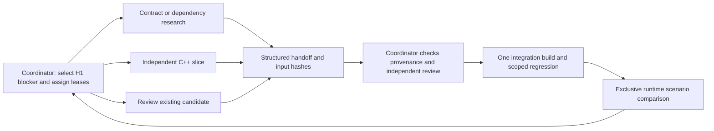

# Agent workflow for semantic reconstruction

The delivery goal is editable C++ with supported behavior and an integrated H1
scenario. Keep one coordinator integrating useful slices while up to three
subagents handle bounded, independent work. Byte-identical output is optional.
This workflow extends the existing [milestone roles](reconstruction-milestones.md)
and [per-function evidence procedure](function-reconstruction-workflow.md).

## Team and operating modes

| Role | Owns | Delivers |
| --- | --- | --- |
| Coordinator / integrator | Task board, shared interfaces/runners, reference ledger, promotion, batch closure, runtime profile | Reviewed integrated behavior, dependency updates, honest milestone state |
| Contract / recon worker | One blocking question and a separately assigned report | Verified callers/layouts/ABI, unresolved assumptions, or an exact capture/support requirement |
| Implementation worker | One behavior or a small coherent family, its candidate TU and focused tests | Readable C++, reproducible bounded differential evidence, per-address records |
| Independent validation worker | Separately assigned test/report files; candidate is read-only | Adversarial boundary/caller checks, negative controls, counterexamples, promotion recommendation |

Use roles dynamically. The usual discovery wave is recon + implementation +
validation. When contracts are ready, use two independent implementation tasks
and a reviewer. When evidence is ready, prioritize review and integration.
Do not keep agents busy with unrelated leaf families just to fill slots.
Keep the topology flat: the coordinator owns the three-worker budget; a worker
does not spawn further agents without an explicit slot and ownership assignment.



## Durable task board

The active board is selected by `agent_workflow_board` in
[`config/reconstruction.json`](../config/reconstruction.json). Its initial H1
tasks are in [`config/agent-workflows/h1.json`](../config/agent-workflows/h1.json).
**Only the coordinator edits the board.** Workers report status through subagent
messages and their handoff; they do not race to update shared JSON or logs.

The initial parallel wave is:

1. `h1-track-contract`: turn the already documented runtime-binding uncertainty
   into a precise observation/capture contract; do not repeat the old BAM audit.
2. `h1-tbb-review`: independently review the existing TBB proposals and their
   original caller evidence for promotion.
3. `h1-alpha-helper`: implement and differentially test the scoped alpha helper
   at `0x0029BDB4` without changing shared runner code.

Later tasks capture actual track state, review the alpha caller, promote the TBB
dependencies, and integrate a specific menu/fade slice. The dependency graph
prevents treating a synthetic callback candidate as an observed runtime binding.
These are planned tasks, not claims that their implementations or validation exist.

Task state is separate from evidence level:

`queued → claimed → working → review → accepted`

`blocked` requires a precise blocker and unblock condition and releases the
worker. Preserve partial files; the coordinator explicitly reassigns them if
work resumes. `accepted` means this task's bounded deliverable was reviewed.
Accepting a research report does not mean a game function was reconstructed,
and accepting a candidate does not mean H1 or its runtime scenario is complete.

Before dispatch, assign one owner, check dependencies, and validate the board:

```powershell
python tools/agent_workflow.py check
python tools/agent_workflow.py ready
```

The checker detects dependency cycles, duplicate IDs/function claims, active file
and frozen-input conflicts, shared resource collisions, coordinator-only edits,
and CPU/worker budget violations. File leases are planning rules, not OS locks.
Keep one active board; the checker does not coordinate unrelated boards/processes.

## Dispatch with a small, explicit context

For a task that is ready, the coordinator changes its state to `claimed` and sets
`owner` to the subagent's assigned name. Validate again, then prepare a fresh run:

```powershell
python tools/agent_workflow.py check
python tools/agent_workflow.py prepare --task h1-alpha-helper --run run-001
```

This writes `task.json` and `brief.md` under
`build/agent-work/H1-semantic/h1-alpha-helper/run-001/`. It refuses to overwrite a
run. `--draft` can preview a schedulable queued task without claiming or launching
it; draft packets cannot authorize a handoff.

The packet includes the actual Git HEAD, task scope, reference image identity,
hashes of declared working-tree inputs, baseline hashes of owned inputs, and a
private output root. It therefore captures uncommitted inputs instead of assuming
HEAD contains this checkout's current tools. Do not create a fresh worktree from
HEAD and silently lose uncommitted support code. Shared checkout plus disjoint
leases is the default; use another worktree only when it is actually useful and
has the required reviewed source state and local private inputs.

Use the internal subagent tools, not new user-owned chats. A lean dispatch uses
`collaboration.spawn_agent` with `fork_turns="none"` and a short message containing:

> Work in the absolute semantic checkout path. Read AGENTS.md,
> docs/agent-workflow.md, and the absolute prepared brief/task.json paths.
> Your assigned owner is NAME. Edit only the listed files, keep inputs frozen,
> use the assigned compiler/output budget, and return a handoff path plus blockers.

The file packet provides the detailed context; do not copy the entire repository
or conversation into each prompt. Use `send_message` for updates and
`followup_task` to reassign an idle agent after accepting/releasing its old task.
Do not recursively spawn or message unrelated Codex chats. Explicit user
instructions always take precedence over this workflow.

## Ownership and validation resources

| Operation | Parallel rule |
| --- | --- |
| Disassembly, caller mapping, contract research | Read-only and parallel |
| Candidate/test/report edits | One writer per assigned file or directory; no overlapping function implementation claims |
| Shared headers, runner, ledger, board, milestone/global reports | Coordinator or one explicitly reassigned prerequisite owner; pause dependent work first |
| Candidate compilation | Separate output per task/run; normally one compiler per worker |
| Independent bulk compiler processes | Always distinct `--out-dir`; divide CPU allocation across them |
| Full regression, canonical build, progress/reference audit | One coordinator-owned closure; freeze sources and stop competing compiler jobs |
| Emulator, debugger, test profile or installed patch | One explicitly assigned runtime owner; autonomous via private loopback-bound `azahar.exe` + Python GDB RSP scripts |

## Agile autonomous emulator verification and anti-bureaucracy rules

To keep milestones agile and avoid blocking on manual user playtesting:

1. **Offline-first gate before any emulator launch:**
   - Every C++ reconstruction and code-cave/IPS patch must pass static ARM/Thumb interworking checks (verifying bit 0 on function pointers and branch instructions) and offline Unicorn/ARM differential + caller-composition runners (`tools/semantic_experiment.py`, `tools/h2_caller_validation.py`, or milestone-specific offline harnesses) before launching Azahar.
   - Never use the emulator for blind trial-and-error debugging of crashes that can be caught by static or Unicorn checks.

2. **Autonomous GDB RSP verification (zero user playtesting by default):**
   - Use the private Azahar build (`build/agent-work/H2-semantic/h2-private-azahar-source/build-clang64/bin/Release/azahar.exe`), whose GDB stub (`src/core/gdbstub/gdbstub.cpp`) is bound strictly to `127.0.0.1` (`INADDR_LOOPBACK`) and supports `qfProcessInfo`.
   - Drive runtime verification autonomously from Python via GDB RSP (`127.0.0.1:<port>`): attach to `sdds4`, set execution breakpoints (`Z0,<addr>,4`), read/verify work structs and globals (`g_ConfigBytes`, `TitleConfigWork`, `TitleMainWork`, etc.), use temporary one-frame logical trigger stubs or state transitions as documented in [`docs/emulator-testing-guide.md`](emulator-testing-guide.md), and terminate the child process automatically (`proc.terminate()`).
   - Do **not** require the user to manually play through menus or press hotkeys (`Ctrl+Shift+F8`) unless a milestone explicitly requests human visual/audio sign-off after automated verification passes.
   - Do **not** inject `CallHostFunction` or `AddTicks` hooks into Dynarmic's JIT translator (`arm_dynarmic.cpp`); use GDB software breakpoints (`Z0`), which Dynarmic handles natively at full JIT speed with synchronized register state.

3. **Lean task board (no bureaucratic task chains):**
   - Keep task boards focused on meaningful C++ reconstruction slices, contract discovery, and milestone integration.
   - Do **not** create separate multi-task chains (`implement -> review -> pin-sync -> pin-sync-review`) merely to update a script's SHA-256 pin or test fixture; bundle script/test updates and their hash pins into a single task or coordinator integration step.

On this 8-logical-CPU machine, the board budget is eight compiler jobs total,
not eight per agent. Single candidate TUs already use one compiler. If a worker
needs the bulk helper, specify both `--jobs` and a private `--out-dir` within its
allocation. The coordinator can use all eight for the closure build after worker
compiles stop. Prefer focused checks during work and one wider closure per batch.

`build_check.py` writes `.o`, `.o.d` and `.o.json`, removes manifests before a
rebuild, and has no cross-process output lock. Its internal TU thread pool is
safe for its own distinct objects; two processes writing the same object are not.
`verify_decomp.py` and `progress.py` may rebuild stale canonical objects, so they
are not read-only worker commands. `tests.test_build` also touches the canonical
cache. Inspect a test module's side effects before allowing concurrent execution.

Freeze all relevant inputs while testing, including transitive headers and shared
runner code. `read_paths` is the minimum declared snapshot, not automatic complete
dependency tracing. An interface/runner change is an integrator-owned prerequisite:
stop dependent validation, update the contract, and invalidate/re-run affected
evidence. Never edit a candidate while another agent reviews/tests its old body.

Use command-specific child paths under the packet output root, such as
`checks/seed-7/` and `checks/seed-20261024/`. Do not pass the already-created packet
directory to a runner that requires a new output directory. Inspect `--help`:
`semantic_experiment.py` and TBB use output **directories**, while
`title_transition_ready_path_experiment.py` writes an output **file**.

Reuse existing runner infrastructure within its actual scope. The shared
`compile_candidate_symbols` helper validates relocation-free leaf code; it is not
a generic non-leaf/VFP runner. Family scaffolding generates review material, not
implementations. For unsupported calls/relocations/VFP, request a bounded,
integrator-owned support task and tests. Do not weaken a validator to obtain green.

## Handoff, independent review and promotion

Use [`templates/agent-handoff.json`](templates/agent-handoff.json) for one handoff
per task; link to the existing function records instead of duplicating them.
The [task brief template](templates/agent-task.md) describes the minimum dispatch
and review contract. Include:

- Bounded result, addresses, owned files, source/reference/object identity,
  interface decisions and original dependencies still called.
- Exact command argument lists and exit codes, fresh report paths and hashes,
  seeds, directed coverage, negative controls and the first counterexample.
- Separate compiled, ARM differential, caller and runtime evidence levels.
  `partial` and `not_run` are valid facts, not equivalent to `passed`.
- Remaining assumptions, missing private fixtures, blocker/unblock condition
  where needed, and the precise next action.

The coordinator verifies the packet/handoff while the same owner is still assigned:

```powershell
python tools/agent_workflow.py check-handoff --packet <run>/task.json --handoff <run>/handoff.json
```

The checker validates declared ownership, assignment, frozen inputs, current file
and report hashes, task/run report location and command-exit records. It cannot
prove that commands ran, infer the truth of `passed`, detect undeclared edits, or
automatically reconcile every runner's embedded source hashes. Independently
inspect the diff, contract, source/report identity, controls and selected reruns.
No machine-generated packet or report existence grants semantic approval.

The implementer must not be its only reviewer. Assign independent review to a
free worker or perform it as coordinator. Freeze implementation files; the
reviewer owns separate tests/notes. Any correction returns to the implementation
owner and invalidates affected evidence. Promotion follows a reviewed candidate
and caller contract, then a reproducible patch/build and an explicitly scoped
runtime comparison. Preserve truthful exact labels when source differs.

When a task blocks, stop repeating the same hypothesis. Return the smallest
counterexample and the concrete missing evidence/support. Reassign the freed
worker to an H1 dependency or independent review. Do not pad throughput with
unrelated families. Do not close the milestone because all task owners replied.

## Batch closure and progress

The coordinator freezes the integrated batch, inspects ownership/diffs, runs the
affected regression/build once, and owns any original-versus-patched runtime
session. Run exact-reference audits when exact claims/verifiers change; identical
bytes are not the semantic acceptance gate. Preserve previous user changes and
stage/commit only explicitly owned work when authorized by the session.

Measure coherent slices promoted, critical blockers removed, original dependencies
remaining and runtime scenarios compared. Record retried failures and unvalidated
candidates to expose wasted work. Function counts, static links, byte matching,
test counts and one successful boot are supporting facts, not a completion score.
Update the task board, function/milestone records and concise MODLOG entry; refresh
generated summaries only at the integration boundary. Leave a clear next ready
task rather than a pile of unowned parallel experiments.
